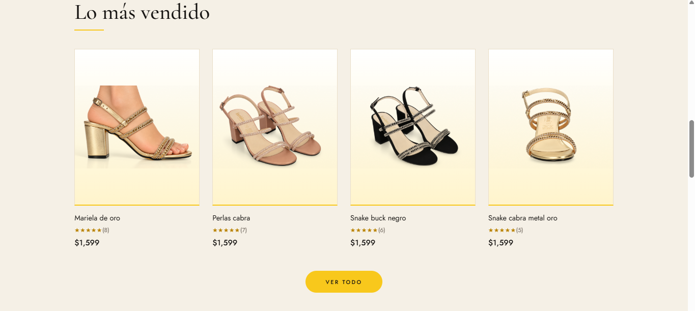

# Vanidiosas by Gonsa

Full-stack e-commerce project for a footwear brand: **Astro + React + Tailwind CSS** on the frontend and **Java + Spring Boot** on the backend.

This is a real client project. The frontend is in progress and the backend is planned as the next phase.

> **Status:** Frontend in progress. The cart, checkout and review form are UI demos for now. They will be connected to the backend API.
>
> **Backend repository:** coming soon (`vanidiosas-api`).


## Features

- Home page with announcement bar, hero, collections, best sellers, benefits, customer reviews and footer.
- Product pages generated automatically from a JSON data file (`/products/[slug]`).
- Product purchase panel with size selector, quantity control and add-to-cart / buy-now actions, including validation.
- Design system built with Tailwind CSS v4 design tokens: colors and fonts are defined in one place.
- Accessibility basics: semantic HTML, ARIA labels on icon buttons and descriptive image alt text.
- Fast pages: static output, lazy-loaded images and JavaScript only where it is needed.



## Tech stack

| Layer | Technology | Status |
| --- | --- | --- |
| Framework | Astro | In use |
| UI | React (interactive islands), TypeScript | In use |
| Styling | Tailwind CSS 4 | In use |
| API | Java, Spring Boot, Spring Web (REST) | Planned |
| Security | Spring Security (JWT, roles, password hashing) | Planned |
| Persistence | Spring Data JPA, Hibernate, MySQL | Planned |
| Validation | Bean Validation | Planned |
| Testing | JUnit 5, Mockito | Planned |
| API docs | OpenAPI (Swagger UI) | Planned |
| Build tool | Maven | Planned |

## Architecture

```text
Browser ─► Astro / React frontend ─► Spring Boot REST API ─► MySQL
                                          │
                                          └─► Payment gateway (webhooks)
```

The backend will follow a layered design: controllers, services and repositories, with DTOs and centralized error handling.

## Getting started

Requirements: Node.js 22.12 or higher.

```bash
git clone <repository-url>
cd Vanidiosas
npm install
npm run dev
```

The site runs at `http://localhost:4321`.

| Command | Description |
| --- | --- |
| `npm run dev` | Start the development server |
| `npm run build` | Build the site for production |
| `npm run preview` | Preview the production build |

## Project structure

```text
src/
  components/
    home/      Hero, Collections, BestSellers, Benefits, Reviews
    layout/    AnnouncementBar, Navbar, Footer
    product/   ProductPurchase (React island), Recommendations
  data/        products.json
  layouts/     Layout.astro
  pages/       index.astro, products/[slug].astro
  styles/      global.css (design tokens)
  utils/       format.ts
public/
  images/      Brand and product images
```

## Technical decisions

- **Astro islands:** pages are static HTML. Only the purchase panel is a React component, so the browser downloads very little JavaScript.
- **Data-driven pages:** products live in `products.json`. Adding a product creates its page automatically. Later this file will be replaced by calls to the REST API.
- **Design tokens:** brand colors are defined once in `global.css`. A palette change is a one-line edit.
- **Conventional Commits:** the history uses `feat:`, `fix:`, `style:`, `refactor:` and `docs:` prefixes.

## Roadmap

**Frontend**

- [x] Home page
- [x] Product detail page (UI)
- [ ] Mobile navigation menu
- [ ] Product listing and collection pages
- [ ] Cart state and persistence

**Backend**

- [ ] Spring Boot project setup and MySQL schema (products, variants, orders, users, reviews)
- [ ] Products REST API, connected to the frontend
- [ ] Authentication and authorization with Spring Security
- [ ] Cart and orders
- [ ] Reviews API with moderation
- [ ] Payment gateway integration
- [ ] Unit and integration tests
- [ ] Deployment

## Author

**[Alexis Uriel Castillo Hernandez]**
[GitHub](https://github.com/AlexisUriel394255) · 
[LinkedIn](https://www.linkedin.com/in/alexis-uriel-castillo-hernandez/?isSelfProfile=true) ·  Email:uclastle9112342@gmail.com